# 智能量子计算机 · 重点实验室 — DSH 启动屏与主题

> **一个插件，两件事**：给 DeepSeek Harness 换上一套「暗色金属控制台 + 红色 HUD 屏」的
> **启动屏**，以及**同色板的界面主题**。再带上两枚官方徽标 —— UEG 徽标（静态）与
> BSC 橄榄枝徽标（**原动画完整保留**、颜色跟随主题、可换任意配色）。
>
> 启动序列里还有：**BSC 实验室工牌准入**（《流浪地球2》北京航天中心的 IQC 胸卡，正反两面扫描翻面，
> 姓名/编号/实验室/职务都能在设置里改，默认图恒宇）、**三段语音播报**（音色与节奏参照
> `dsh-startup-screen`：神经网络女声优先、0.88 语速、0.85 音调、念前提示音）。

配色不是写死的：**6 套预设 + 全量自定义**，所有派生色（面板、线条、文字阶梯、发光）
都由 4 个基色用 `color-mix()` 现算 —— 改一只主色，整屏整界面一起变。

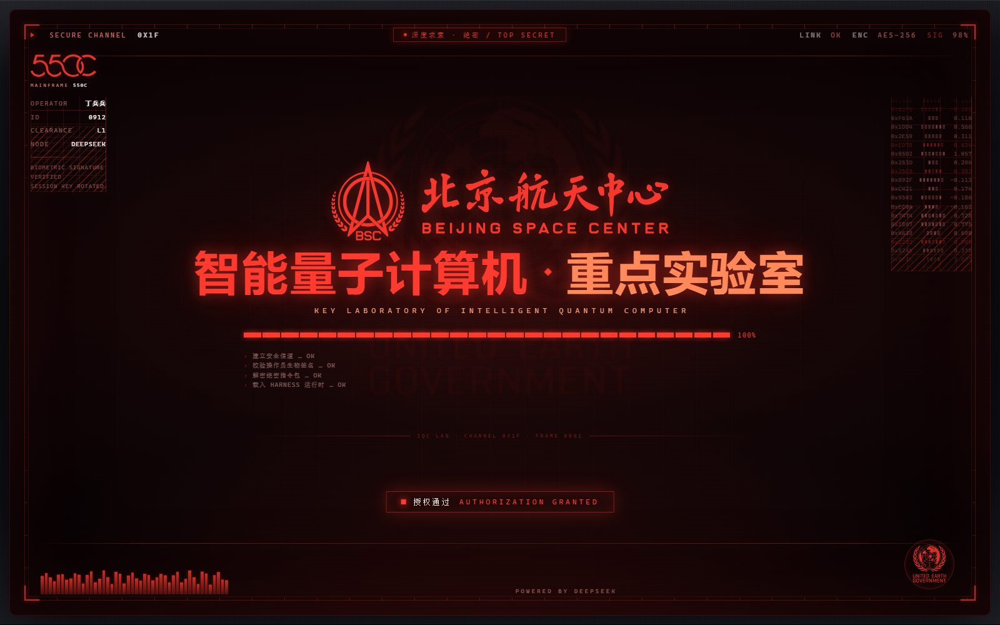
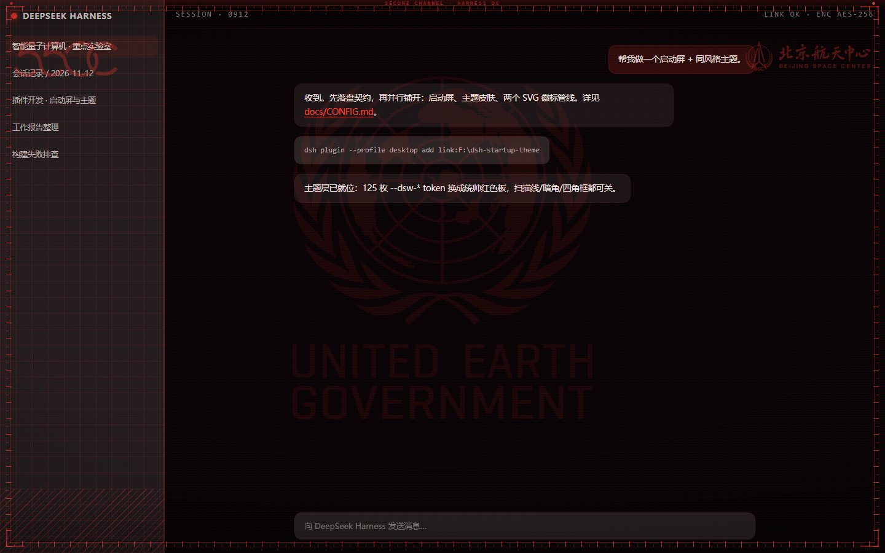

---

## 目录

- [它长什么样](#它长什么样)
- [安装 / 卸载](#安装--卸载)
- [能调什么（设置 → 流浪地球主题）](#能调什么设置--流浪地球主题)
- [配色系统](#配色系统)
- [两枚徽标](#两枚徽标)
- [启动屏编排（时间线）](#启动屏编排时间线)
- [安全与容错](#安全与容错)
- [目录结构](#目录结构)
- [开发与验证](#开发与验证)
- [已知边界](#已知边界)

---

## 它长什么样

| 启动屏（进度 / 日志阶段） | 启动屏（授权通过） |
|---|---|
| 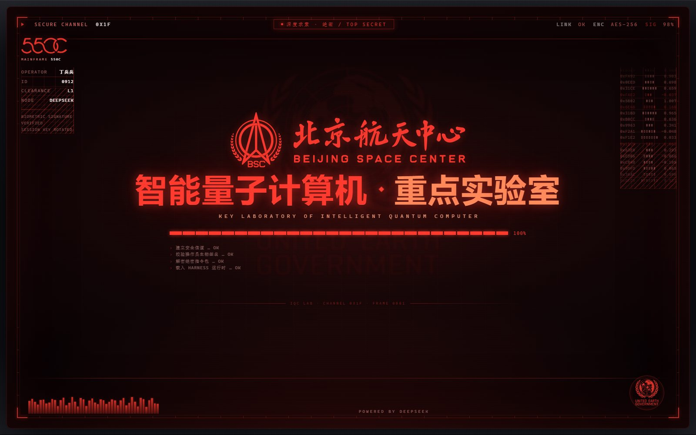 | 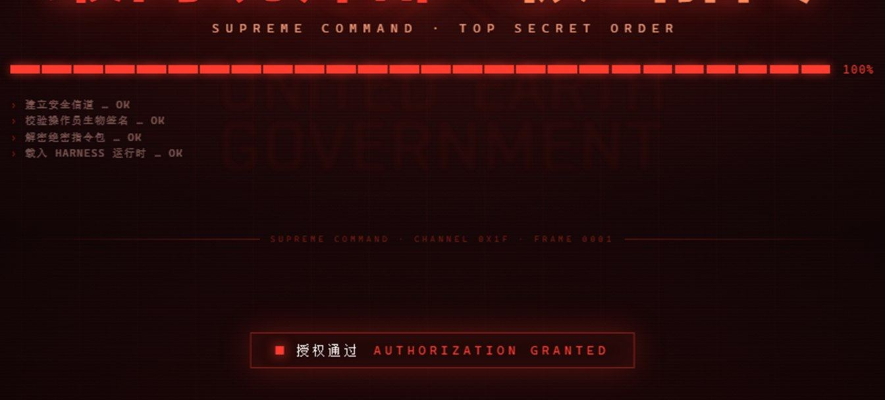 |

| 界面主题：统帅红 | 界面主题：全息青 |
|---|---|
|  | 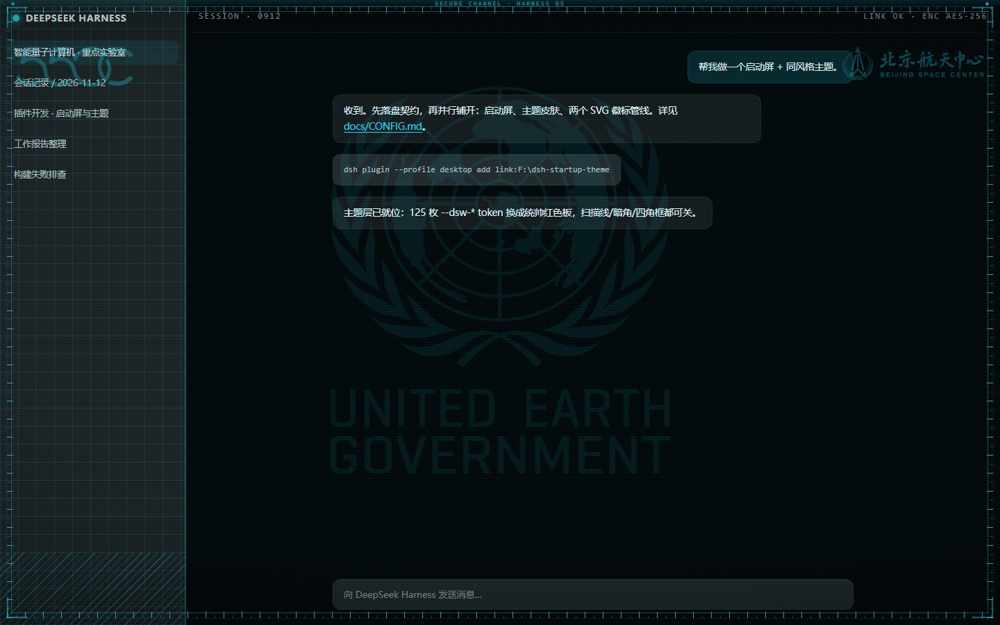 |

| BSC 徽标动画中段 | 徽标终态 |
|---|---|
| 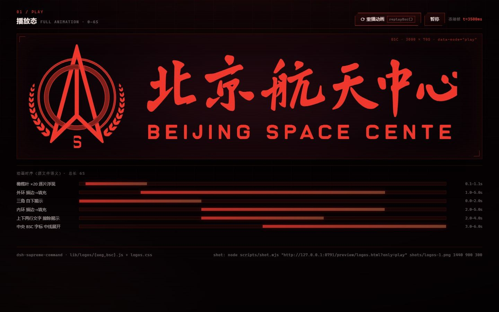 | 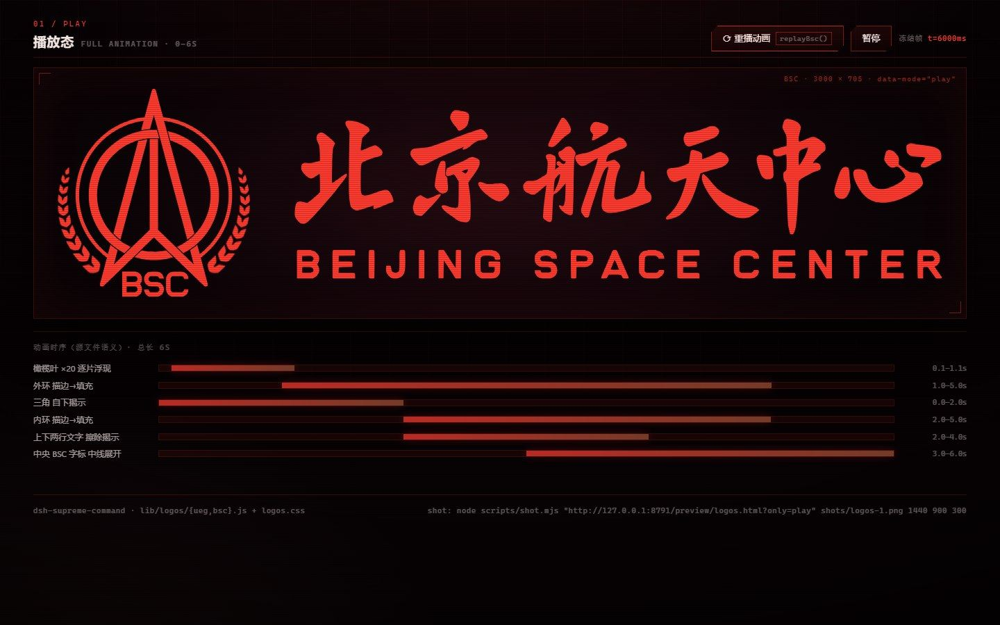 |

| 工牌准入（背面 · 姓名/编号/职务） | 工牌正面（IQC + 条码） |
|---|---|
| 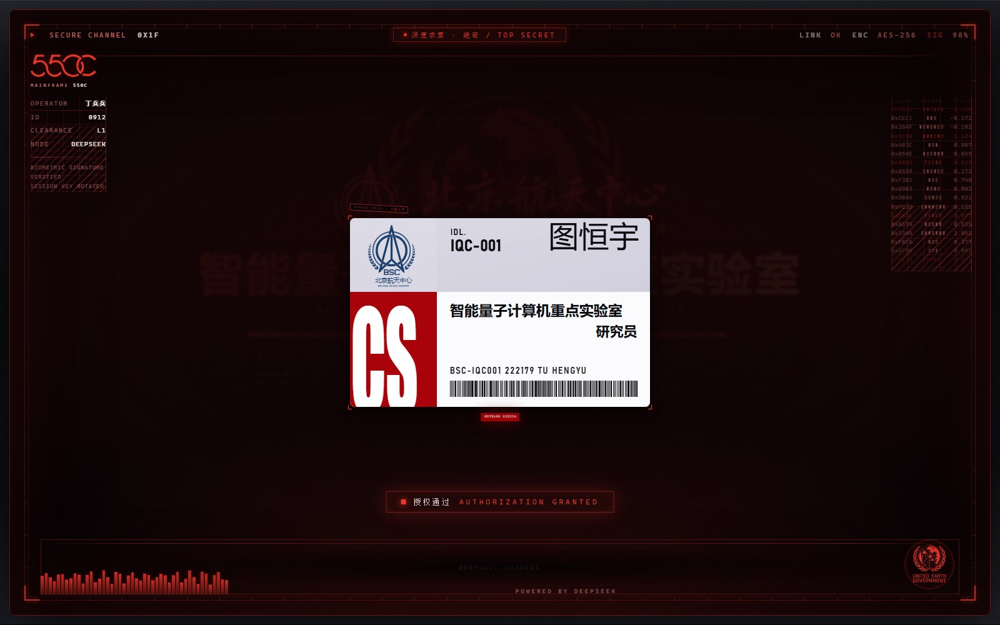 | 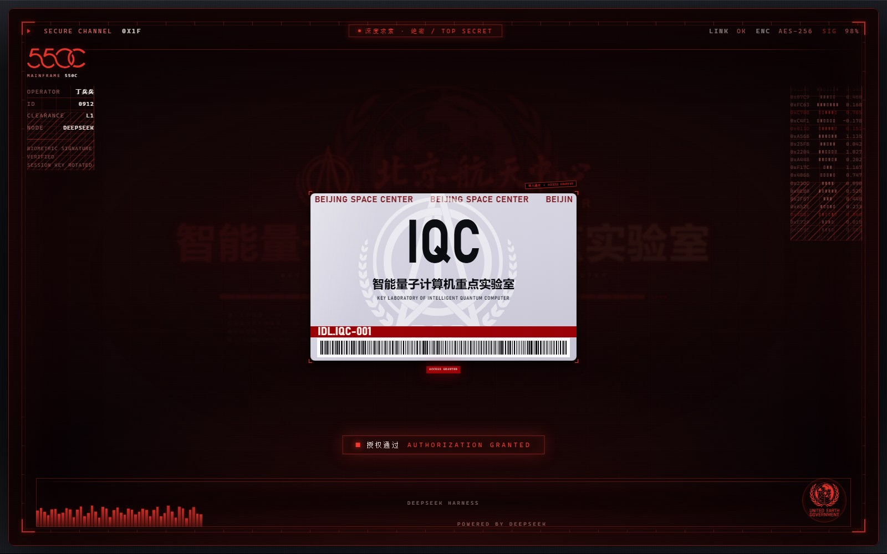 |

---

## 安装 / 卸载

**要求**：Node.js ≥ 20（DSH 自带运行时，一般不用另装）；DSH 版本 ≥ `0.2.2-rc.1`（见[已知边界](#已知边界)）。

### 从 GitHub 安装（推荐，不需要 npm 账号）

一条命令（PowerShell）——克隆到 `~/.dsh/local-plugins/` 再装进 desktop profile：

```powershell
irm https://raw.githubusercontent.com/langyan1022/dsh-supreme-command/main/install.ps1 | iex
```

需要 `git` 和 `node ≥ 20`（DSH 用户一般都有 Node；没有就先装 Git for Windows + Node.js）。

脚本参数（本地执行时用）：

```powershell
.\install.ps1                   # desktop profile
.\install.ps1 -Profile web      # web profile
.\install.ps1 -ReplaceStartup   # 顺带停用其它启动屏插件
.\install.ps1 -Uninstall        # 卸载
```

> 以后更新：再跑一次同一条命令（会 `git reset --hard origin/main` 到最新版，然后重装/刷新联接）。

也可以在 **设置 → 插件 → 安装插件** 里直接填：

```text
github:langyan1022/dsh-supreme-command
```

或命令行：`dsh plugin --profile desktop add github:langyan1022/dsh-supreme-command`
（走 DSH 内置 pnpm；如果本机 pnpm 对 git 源有限制，用上面的 `install.ps1` 更稳）。

### 从 npm 安装（待发布）

```text
dsh-supreme-command
```

> 发布/维护细节见 [docs/PUBLISH.md](docs/PUBLISH.md)：
> DSH 的"插件市场"目前只收**官方**组合包（随安装提供 + 官方可选包），
> 第三方插件的分发方式是 **GitHub 仓库或 npm 包**，不经过市场目录。

### 一键安装

```powershell
# 在插件目录里执行（也可以直接双击 安装.cmd）
node scripts/install.mjs
```

脚本做两件事，都可以单独回退：

1. 在 `~/.dsh/profiles/desktop/node_modules/` 下建一个**目录联接**指向本插件目录；
2. 往 `~/.dsh/profiles/desktop/cordis.patch.yml` 追加一段**带注释标记的 insert 条目**（原文件自动备份）。

装完 **完全退出 DSH 再打开**（Web 版：关掉 `dsh web` 进程再起）。刷新页面就能看到启动屏，
进界面后是 HUD 主题。

可选参数：

```powershell
node scripts/install.mjs --profile web        # 装到 web profile
node scripts/install.mjs --dry-run            # 只打印将要做的事
node scripts/install.mjs --replace-startup    # 顺带停用 profile 里其它启动屏插件（推荐）
node scripts/install.mjs --uninstall          # 卸载（删联接 + 删托管块）
```

> ⚠️ 不要**同时**用 `dsh plugin add` 和本脚本安装：那会让插件注册两遍，`apply` 跑两遍，
> 路由重复注册会报错。若你之前手工加过同名条目，脚本会检测到并中止。
> 详见 [docs/INSTALL.md](docs/INSTALL.md)。

> ⚠️ **别和别的启动屏插件一起开**：两个"全屏启动动画"同时启用会叠播（同为 `z-index: 2147483000`）。
> 本插件检测到 `dsh-startup-screen` 等插件的痕迹会**主动让位不播放**（控制台会有提示），
> 界面主题不受影响。想让本插件接管启动屏，用 `--replace-startup` 装：
> 它只把对方从 `dsh.profile.bundles` 里摘掉（**不卸载、不删配置**，随时能加回去），
> 并会把 `package.json` 备份一份。
>
> 这台机器上已经用 `--replace-startup` 装好了（desktop profile）：联接 + patch 托管块 + 停用
> `dsh-startup-screen`。**完全退出 DSH 再打开**就能看到新启动屏与主题。

### 卸载

```powershell
node scripts/install.mjs --uninstall     # 或双击 卸载.cmd
```

---

## 能调什么（设置 → 流浪地球主题）

设置页里新增一个分区 **「流浪地球主题」**（顺序 27），四组面板：

| 组 | 字段 | 说明 |
|---|---|---|
| **配色** | `preset` | 6 套预设色卡，点一下整套配色跟着换 |
| | `accent` / `accent2` | 主色 / 辅色（HUD 线条、标题、按钮、徽标主色） |
| | `bgBase` / `textPrimary` | 画布底色 / 正文色；留空 = 跟预设 |
| | `themeMode` | `force-dark` 固定暗色（原生控件也暗）/ `auto` 原生控件交还系统 |
| **质感** | `glow`(0–2) | 发光强度：文字辉光、线条发光、扫描带亮度一起缩放；`0` = 全关 |
| | `scanlines`(0–1) | 扫描线密度/亮度；`0` = 完全消失 |
| | `grain`(0–1) | 网格/颗粒 |
| | `vignette`(0–1) | 暗角 |
| | `hudFrames` | 面板四角 HUD 直角框开关 |
| **启动屏** | `splashEnabled` | 启动屏总开关 |
| | `mode` | `always` 每次刷新 / `session` 每会话一次 / `daily` 每天一次 |
| | `speed`(0.5–2) | 整段动画速度倍率 |
| | `allowSkip` | 允许 Esc / Enter / 空格 / 点击跳过 |
| | 9 个文案字段 | 标题、副标、组织、密级、操作员、页脚…… |
| | `statusLines` | 状态日志，一行一条 |
| | `showUeg` / `showBsc` | 两枚徽标分别开关 |
| | `logoColor` / `logoCustom` | 徽标着色：主色 / 辅色 / 正文色 / 自定义 |
| | `sound` / `soundVolume` | 界面音效（WebAudio 合成，无音频文件） |
| **关于** | — | 版本、配置文件路径、恢复默认、重播启动屏 |

配置落在 **`~/.dsh/dsh-supreme-command.json`**（不走 DSH 的 settings 命名空间，
不受 `dsh-settings` 版本漂移影响）。**改完刷新页面即生效，不用重启**。

也可以直接手改这个 JSON，或调接口：

```powershell
curl http://127.0.0.1:10022/dsh-command/config                      # 读
curl -X POST http://127.0.0.1:10022/dsh-command/config -d '{"patch":{"preset":"cyan"}}'
curl -X POST http://127.0.0.1:10022/dsh-command/config -d '{"action":"reset"}'
```

---

## 配色系统

| 预设 id | 名称 | 主色 | 辅色 | 底色 |
|---|---|---|---|---|
| `command-red` | 统帅红（默认） | `#ff3b30` | `#ff8a5c` | `#080305` |
| `amber` | 琥珀终端 | `#ffb020` | `#ffd76a` | `#0a0703` |
| `cyan` | 全息青 | `#22d3ee` | `#7dd3fc` | `#03080a` |
| `green` | 战术绿 | `#35e07a` | `#a3e635` | `#040a06` |
| `violet` | 深空紫 | `#a855f7` | `#e879f9` | `#08040e` |
| `mono` | 冷白机 | `#e5e7eb` | `#9ca3af` | `#09090b` |

**只有 4 个基色是真值**，其余全部现算：

```css
/* 面板层级：底色 + 一点正文色 → 石墨金属，不掺主色 */
--dsc-bg-1: color-mix(in srgb, var(--dsc-bg) 92%, var(--dsc-text) 8%);
/* 线条：主色的发丝级透明版 */
--dsc-line: color-mix(in srgb, var(--dsc-accent) 16%, transparent);
/* 文字阶梯：正文色往底色收 */
--dsc-text-2: color-mix(in srgb, var(--dsc-text) 78%, var(--dsc-bg));
```

所以「改主色」不会只变几个按钮 —— 描边、选中态、发光、徽标、启动屏扫描线会一起走。
换了 `accent` 但没换预设时，`preset` 自动落到 `custom`，界面不会骗你。

> 设计取向：这是**生产力界面**，不是海报。正文接近白（`#f3e7e4`，对底色 16.9:1），
> 主色只出现在描边、选中、链接、按钮、徽标这些「HUD 发光件」上。

---

## 两枚徽标

你给的两个 Illustrator 文件都被**逐字节保留几何路径**，只做了四件事：
作用域化、`currentColor` 换色、`id`→`class`、删掉页面级全局选择器（`:root`、`svg{padding:30px}`）。

### UEG 徽标（`lib/logos/ueg.js`，3000×3500，静态）

- 4 条路径全部保留；类名 `dsc-ueg-*`。
- 用在启动屏两处：右下角**圆形印章**，以及标题后**极淡的大水印**（opacity ≈ 0.03 + 微模糊）。

### BSC 橄榄枝徽标（`lib/logos/bsc.js`，3000×705，动画）

26 条路径 + **原动画一条不少**：

| 动画 | 源语义 | 产物 |
|---|---|---|
| 橄榄枝 20 片逐叶浮现 | `olive-display`，100ms/片，延迟 ×10…×1 | 保留，节拍变量 `--olive-leaf-display-time` 可覆盖 |
| 内环描边→填充 | `fillAnimation 3s`，delay 2s，dasharray/offset 2000 | 保留 |
| 外环描边→填充 | `fillAnimation 4s`，delay 1s | 保留 |
| 中央三角自下揭示 | `clip-path inset(100% 0 0 0)` → `0`，2s | 保留 |
| 上下两行文字擦除 | `clip-path inset(0 100% 0 0)` → `0`，2s，delay 2s | 保留 |
| 中央 BSC 字标中线展开 | `clip-path inset(0 50% 0 50%)` → `0`，3s | 保留（delay 3s，见下） |

用法：

```html
<div class="dsc-bsc" data-mode="play"> …BSC_SVG… </div>   <!-- 播放 -->
<div class="dsc-bsc" data-mode="still"> …BSC_SVG… </div>  <!-- 直接终态 -->
<div class="dsc-ueg"> …UEG_SVG… </div>
```

- **改色**：根 `svg` 上是 `color: var(--dsc-logo, currentColor)`，
  所以 `--dsc-logo`、外层 `color`、或设置页的「徽标着色」三者都能改，填充与描边一起走。
- **重播**：`import { replayBsc } from './lib/logos/bsc.js'; replayBsc(container)`。
- **省电/无障碍**：`prefers-reduced-motion: reduce` 时等同 `still`（直接终态，不闪动）。
- 源文件里中央字标把 `animation-delay:3s` 写在了 `animation` 简写**之前**，实际会被重置成 `0s`；
  这里按作者意图实现为真 3s。想要 1:1 复刻浏览器的实际（0s）表现，把 `lib/logos/logos.css`
  里那条 `animation-delay` 改成 `0s` 即可。

---

## 启动屏编排（时间线）

全屏 HUD：机壳 → 屏体 → 顶栏 / 左右信息栏 / 中央核心 / **工牌准入** / 底部遥测 / 授权横幅。
`speed=1` 时全程约 **11 秒**（工牌停留 `badgeHold` 可调；授权画面还会再停 ~2.4s 才淡出 720ms 收尾）：

| 时间 | 事件 |
|---|---|
| 0.00s | 黑幕 + 机壳点亮，一道扫描带自上而下扫过 |
| 0.22s | HUD 框线、四角直角标、技术网格、边缘刻度落位 |
| 0.32s | 顶部导轨、左右信息栏点亮；右侧伪遥测数据流开始滚动 |
| 0.42s | **BSC 徽标开播**（逐叶 → 双环 → 三角 → 文字） |
| 0.90s | 标题「智能量子计算机 · 重点实验室」逐字砸下（每字 42ms 错位 + 模糊收敛）+ 第 1 句播报 |
| 1.56s | 英文副标字距收拢 |
| 1.82s | 分段进度条推进 + 频谱条跳动 + 状态日志逐条打出（每行一声轻响） |
| 3.05s | **工牌准入**：核心内容退成背景，胸卡升起（正面 IQC + 编号带 + 条码） |
| 3.31s | 扫描线自上而下扫过卡面 |
| 4.35s | 扫完**翻到背面**（姓名 / 编号 / 实验室 / 职务 / 条码） |
| 5.05s | 「准入通过 · ACCESS GRANTED」+ 第 2 句播报（操作员验证通过） |
| 5.05s + `badgeHold`（默认 2.4s） | 工牌停留在这里，足够看清姓名 / 编号 / 条码 |
| 退场后 ~0.4s | 工牌退场、核心内容恢复；「授权通过 / AUTHORIZATION GRANTED」横幅 + 第 3 句播报 |
| 授权后 ~2.4s（终幕语音没念完就等它念完） | 收尾：720ms 淡出，再移除遮罩、解锁页面 |

- **跳过**：Esc / Enter / Space / 点击任意处（`allowSkip=false` 时禁用；跳过会同时掐掉语音）。
- **只播一次**：`mode=session` 用 `sessionStorage`，`mode=daily` 用 `localStorage` 记日期；
  标记只在**真的播完之后**才写 —— 中途崩了下次还会再试。
- **重播**：`window.__DSC_SPLASH__.replay()`（设置页「关于」里也有按钮）。

---

## 工牌准入（BSC 实验室胸卡）

启动序列中间那一屏，按《流浪地球2》里北京航天中心（BSC）的**实物胸卡**复刻，正反两面、**没有照片**。
比例是照着你给的实物图量的（卡面 1.586，ID-1 卡），尺寸全部用容器查询单位（`cqh/cqw`），放大缩小都同比例：

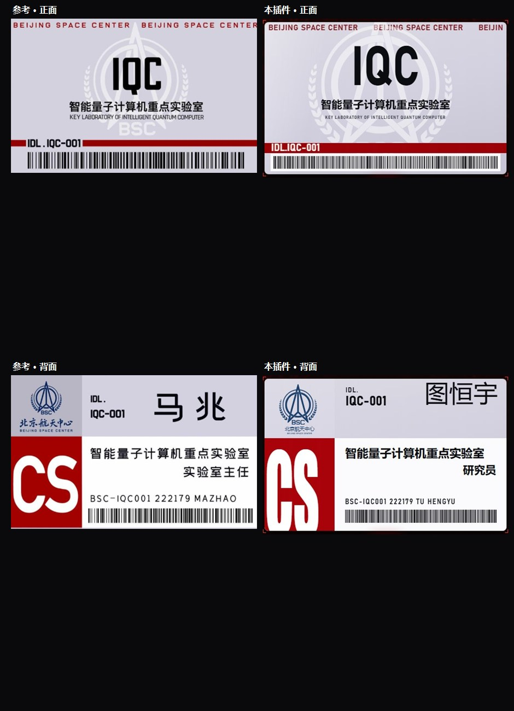

- **正面**：顶部「BEIJING SPACE CENTER」重复红字 → 白色真实 BSC 徽标水印（不是画的假章，就是插件自带的那枚 BSC SVG）→
  巨大 `IQC`（优设标题黑，笔画加粗到参考图的重量）→ 实验室中英文名 → 深红编号带 `IDL.IQC-001` → 白底条码区。
- **背面**：左列 29% ＝ 上半蓝色真实 BSC 徽标 + 北京航天中心 + 下半红底巨大 `CS`；右列 71% ＝
  上半 `IDL.` `IQC-001` 与右侧大姓名，下半白面板里实验室名 / 职务（右对齐）/ 编码行 `BSC-IQC001 222179 TU HENGYU` / 条码。
- 卡片是**纯 CSS 画的浅色塑料卡**（不引用任何剧照或外部图片），浮在红色 HUD 里被扫描线扫过，
  四角取景框、状态条（`SCANNING` → `ACCESS GRANTED`）、核验章都在卡片外的覆盖层里（不随 3D 翻面镜像）。
- 默认就是**图恒宇**的姓名；姓名 / 正背面编号 / 英文名 / 机构中英 / 实验室中英 / 缩写 / 职务 / 权限，
  设置 → 启动屏 → 工牌准入 里 12 个字段全可改。

### 工牌字体还原

对着参考图放大逐字比对后，按字形选的字面（都是本机/系统可用的字体，不额外下载）：

| 位置 | 参考字形特征 | 本插件用字 |
|---|---|---|
| `IQC` 大字 | DIN 系：窄、笔画等宽、Q 的尾巴垂直下坠、C 端面竖切 | `Bahnschrift SemiBold Condensed`（DIN 克隆） |
| `BEIJING SPACE CENTER` 顶部重复条 / `IDL.IQC-001` 编号带 / 背面编码行 | 同上，DIN 系窄体 + 大字距 | `Bahnschrift SemiBold Condensed` |
| `CS` 红底大字 | 超窄超重压缩体，底部被卡边裁切 | `Impact` + `scaleX` 压窄（Windows 上没有等价免费压缩体） |
| `智能量子计算机重点实验室` / 姓名 / 职务 | 思源黑体系：方头、笔画均匀 | `Noto Sans SC`（Bold / Regular） |
| 徽标下的「北京·航天中心」 | 书法体（属于 BSC 标识本身） | 直接使用真实 BSC SVG 里的原字 |

另外这轮把字号按 **cap-height（≈0.72em）** 反推重标了一遍——之前把"字高占比"直接当 `font-size`，
整张卡的字比参考小约 30%，CS 更是小了近一倍，所以看起来总"不太像"。条码也从重复渐变换成了
确定性随机生成的窄/中/宽三档黑条。

> 电影里那张卡确实没有照片，所以这里**不做头像上传** —— 也就不涉及任何人像素材的版权问题。

---

## 语音播报

音色与节奏按 `dsh-startup-screen` 的做法适配：**先按分数挑音色，而不是"第一个能用的"**。

- 打分顺序：**神经网络音色**（`Natural / Neural / Online / Premium / Enhanced / Siri / Google`）> **女声**（含 `xiaoxiao / huihui / yaoyao` 等中文女声）> **语种吻合** > 本地音色；男声（`kangkang / yunxi / david …`）扣分。
- 语种优先级高于音色档次：念英文时只在英文音色里挑（拿中文音色念英文会很怪）。
- 参数与参考插件一致：`rate 0.88` / `pitch 0.85` / `volume 0.9`，念之前两声轻提示（1046.5 + 1568 Hz），之后留 240ms 再开口。
- 三个播报点：标题砸下、工牌核验通过、授权通过；台词可改，支持 `{operator}` 等六个占位符。
- **素材模式（这台机器已经启用）**：`voiceSource=asset` 时优先播 `lib/assets/voice/{title,operator,grant}.mp3`，
  缺哪个槽位就用合成补哪个。已经用 `node scripts/import-voice.mjs --all` 把参考插件装在本机的真声素材接下来了：

  | 槽位 | 来源素材 | 语义 |
  |---|---|---|
  | `title` | `line-1.mp3` | 「需要访问许可 / ACCESS PERMISSION REQUIRED」 |
  | `operator` | `line-5.mp3` | 「读取完毕 · 核验通过 / READ COMPLETE · VERIFIED」（工牌核验那一刻） |
  | `grant` | `line-6.mp3` | 「Welcome. Authorization granted.」（授权通过那一刻） |

  想换回合成：`node scripts/import-voice.mjs --remove`（或把配置里 `voiceSource` 改回 `tts`）；
  想看看本机还有什么素材：`node scripts/import-voice.mjs --list`。

---

## 字体

**优设标题黑已经下载、装到系统（当前用户）、并随插件打包**：启动屏标题、工牌 `IQC` / `CS` / 姓名都用它。
取字体顺序是「系统已装 → 插件路由 → 相对路径」，所以换台机器没有这个字体时还有兜底：

| 用途 | 字体栈（按优先级） |
|---|---|
| 展示字（标题 / IQC / CS / 姓名） | `YouSheBiaoTiHei`（优设标题黑，已随插件打包）→ `Arial Black` → `Noto Sans SC Black` |
| 中文正文 / 标签 / 实验室名 | `Noto Sans SC` → `Microsoft YaHei UI` → `Microsoft YaHei` → `Source Han Sans SC` |
| 拉丁副字（BEIJING SPACE CENTER / 编号 / 编码行） | `Bahnschrift SemiBold Condensed` → `Bahnschrift Condensed` → `Rajdhani` → `Arial Narrow` |
| 等宽数据 | `Cascadia Mono` → `Cascadia Code` → `Consolas` |

字体文件在 `lib/assets/fonts/YouSheBiaoTiHei.ttf`（1.35 MB，优设网络科技免费商用授权），
运行时经 `/dsh-command/font/YouSheBiaoTiHei.ttf` 只读下发（白名单 + 防目录穿越）。

---

## 主题装饰（水印 / 角落徽标 / 主机型号）

启动屏那套"模糊大徽标 + 角落机型标识"的语汇搬进了界面，全部走 SVG mask + 主题色，换配色自动跟着变：

| 装饰 | 位置 | 做法 | 开关 |
|---|---|---|---|
| **UEG 大徽标水印** | 视口中央偏上 | 真实的 UEG 徽标 SVG 当遮罩、`--dsc-logo` 上色，约 6% 不透明度 + 2.2px 模糊，只在空白处透出来 | `watermark` |
| **北京航天中心（BSC）徽标** | 会话标题栏中间 | 真实 BSC 徽标（同一枚动画徽标的静态件）当遮罩，约 52% 不透明度 + 主题色光晕 | `cornerLogo` |
| **550C 主机型号标识** | 左侧导航栏底部、水平居中 | 由 `550C.svg` 转换来的 scoped 模块，同样 mask + 主题色上色；位置按导航栏宽度算，拖宽/收起都居中 | `modelLogo`（主题）/ `showModel`（启动屏） |

- 装饰层是 Host 注入的 `<div id="dsh-command-deco">`，固定定位 + `pointer-events:none`，不吃点击、不改布局；
  强度跟 `--dsc-hud-ui-alpha` 联动，`hudFrames=0` 时和别的 HUD 装饰一起归零。
- 徽标遮罩走 `/dsh-command/logo/{ueg,bsc,550c}.svg?mask=1`（Host 会把 SVG 刷成全白，取 alpha 上色），
  所以它们永远跟主题色一致，不会出现"红色界面里压着一枚蓝色旧 logo"。
- 启动屏左上角也有 550C 型号标识（`MAINFRAME 550C` 小字标签），和主题左上角那枚是同一个文件。

---

## 桌面端（DSH Desktop）为什么需要自举

DSH Desktop 的主窗口页面是 `dsh-app://app/index.html`，Electron 主进程**直接从打包后的
`dsh-web-frontend/dist` 读静态 index.html**（只额外塞一个 `__DSH_BOOT_READY__`），
不走 webServer 的 index render —— 所以 **Host 端 `tapIndex` 注入在桌面端永远到不了页面**：

- 设置面板是客户端 bundle，照常加载 → 「流浪地球主题」分区看得见；
- 但主题 CSS、装饰层、启动屏根节点都是 Host 注入的 → 桌面端全都不出现。

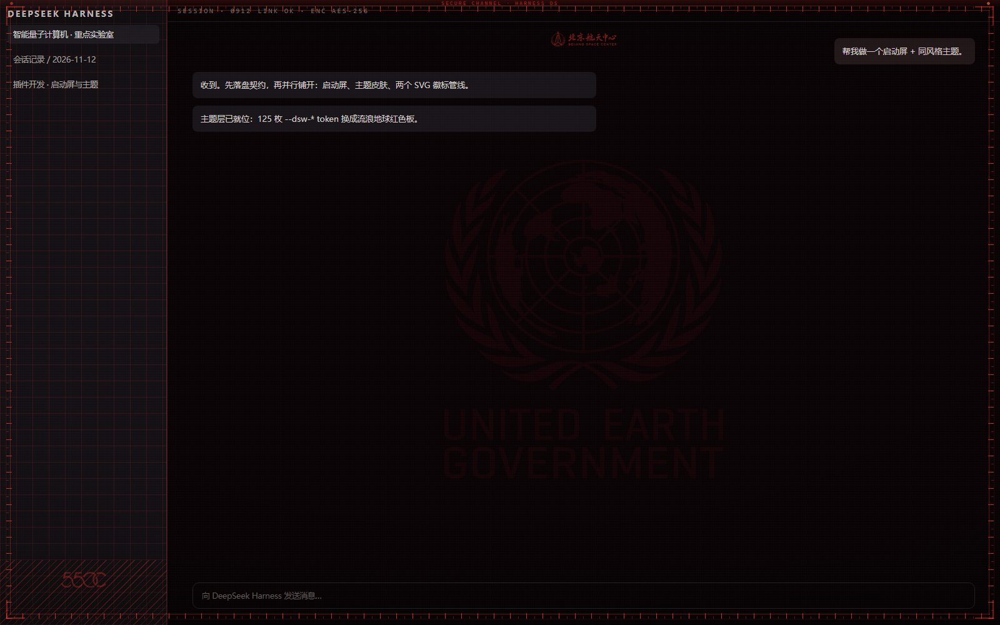

修复方式（和 `dsh-startup-screen` 的 selfBoot 思路一致）：

1. Host 把"注入"本身做成一条路由 `/dsh-command/selfboot.js`（由 `lib/selfboot.js` 生成），
   内容与 tapIndex 注入**完全同一套**：主题属性、变量表、critical CSS、装饰层、启动屏根节点、
   跳过判定、10 秒兜底；
2. 客户端半侧在启动时检查"页面里有没有 Host 注入痕迹"，没有就挂上这个脚本；
3. `dsh-app://app/*` 的其它路径会带 cookie 转发给 Host，所以 `/dsh-command/*` 在桌面端可用。

Web 模式（`http://127.0.0.1:PORT`）仍有 Host 注入，客户端会自动跳过，不会重复注入。
**改完 Host 侧代码必须完全退出 DSH 再打开**（客户端 bundle 与路由都是启动时加载的）。

---

## 启动时最大化窗口

DSH Desktop 的主窗口是固定 `1280×820` 创建的，也不保存窗口尺寸，Electron 主进程又没有把窗口控制
暴露给页面 —— 所以"默认全屏"没法用普通设置做到。插件换了个不改 DSH 本体的做法：

- Host 半侧在启动时（只在 **Windows + DSH Desktop** 宿主里，靠 `DSH_DESKTOP_*` 环境变量识别）
  拉起一个隐藏 PowerShell：找到标题匹配 `DeepSeek Harness` 的主窗口，发一次 `SW_MAXIMIZE`；
- 20 秒内持续看窗口，欢迎页先出现、主窗口后创建也能兜住；已经铺满就直接收手；
- 只发一次窗口消息，**不碰 app.asar、不影响 DSH 更新**；失败就静默，绝不影响启动。

开关：设置 → 流浪地球主题 → 质感 → **启动时最大化窗口**（默认开，改完重启 DSH 生效）。
窗口最大化的效果是"铺满工作区、任务栏可见"；想要连任务栏一起盖住的话告诉我，我把脚本换成真全屏定位。

---

## 免责声明

- 本插件是**非官方同人主题**，视觉语言参考《流浪地球 2》北京航天中心的控制台与工牌，
  与电影版权方、DeepSeek 官方均无隶属关系；
- 插件内**不含任何电影剧照、海报、影片音频或影片字体**：工牌是纯 CSS 绘制，徽标是 SVG 重绘；
- 「UEG」「550C」「北京航天中心」等名称与标识归原权利人；
- 语音素材（`lib/assets/voice/*.mp3`）**不随包发布**，需自行导入；
- 第三方材料与字体授权见 [NOTICE](NOTICE)，代码部分为 MIT。

---

## 安全与容错

这些不是"顺便加的"，每一条都对应一个真实翻车点：

| 问题 | 处理 |
|---|---|
| 首帧闪出宿主白底 | 内联脚本在 `<head>` 里**先挂** `html[data-dsh-command="on"]`，critical CSS 同时把窗口压黑 |
| splash.js 404 / 语法错 / 被拦 | 10 秒兜底：无条件移除遮罩、解锁滚动，**绝不留黑屏** |
| 徽标素材拿不到 | 并行 fetch + 1.6s 超时，拿不到就少两枚徽标继续播 |
| 载体没有 HTTP 路由（`file://` + IPC） | Host 半侧不炸（只记一条 warn）；客户端半侧会自己挂 `/dsh-command/selfboot.js` 做自举，所以桌面端照样生效 |
| 跳过/结束后的监听残留 | 播完解绑键盘/指针监听、清全部定时器与 rAF |
| 用户开了"减少动态效果" | 停掉动画，直接渲染终态并在 1.6s 后收尾 |
| 配色把界面调得不能看 | 正文/面板/线条全部由 `color-mix` 派生，只暴露 4 个基色；对比度见上 |
| 宿主升级改了 token | 只覆盖 `--dsw-alias-*` 语义 token，不改布局/字体族/圆角体系 |

---

## 目录结构

```
dsh-supreme-command/
├── package.json              host ESM + dsh.bundle/dsh.client 声明
├── cordis.patch.yml          安装时被并入 profile 的 bundle patch
├── 安装.cmd / 卸载.cmd        双击安装/卸载
├── lib/
│   ├── index.js              Host：配置、路由、index.html 注入、变量计算
│   ├── palettes.js           6 套预设（唯一色源，同时下发给设置面板）
│   ├── theme.css             界面主题：125 枚 --dsw-* token 映射 + HUD 装饰层
│   ├── splash.css            启动屏样式
│   ├── splash.js             启动屏运行时（时间线 / 音效 / 跳过 / 重播）
│   ├── client.js             设置面板（ModuleLoader bundle，无构建）
│   └── logos/
│       ├── ueg.js            UEG 徽标（scoped + currentColor）
│       ├── bsc.js            BSC 动画徽标 + replayBsc()
│       └── logos.css         全部徽标动画，41 条规则全 .dsc- 作用域
├── preview/
│   ├── index.html            启动屏 + 假 DSH 外壳预览（支持 URL 参数）
│   ├── theme.html            主题样张（仿真 DSH 结构）
│   └── logos.html            徽标检验台（冻结帧 / 三配色 / 运行时自检）
├── scripts/
│   ├── install.mjs           安装/卸载（目录联接 + patch 托管块）
│   ├── serve.mjs             预览静态服务器
│   ├── shot.mjs              无头浏览器截图
│   ├── check-injection.mjs   用真实 DSH index.html 跑注入回归
│   └── check-timeline.mjs    启动屏时间线自检（无头浏览器）
├── test/                     smoke-host / smoke-splash / smoke-client
├── docs/                     CONFIG.md（契约）/ INSTALL.md / logos.md
└── shots/                    验证截图
```

**没有构建步骤**：所有文件就是产物，改完刷新页面即生效。

---

## 开发与验证

```powershell
npm test                        # 112 项静态自检（配置/注入/路由/样式隔离/协议）
node scripts/check-injection.mjs    # 用真实 DSH index.html 验证注入（8 项）
node scripts/check-timeline.mjs     # 启动屏时间线（需预览服务器，14 项）
node scripts/check-guards.mjs       # 护栏：跳过不黑屏 / 与其它启动屏互斥 / 减少动态（8 项）
node scripts/check-voice.mjs        # 语音接线：三句台词 / 音色打分 / 双语 / 占位符（9 项）
node scripts/import-voice.mjs --list # 看看本机有没有可复用的真声素材
npm run preview                 # http://127.0.0.1:8791/preview/index.html
node scripts/shot.mjs <url> <out.png> [宽 高 虚拟时间ms]
```

装好插件后还有一个**真机预览页**：`/dsh-command/preview`（设置面板「关于 → 打开独立预览」也指向它）。
它用和正式注入完全同一套路由与配置单独播一遍，并且**不写"已播过"标记**。

预览页 URL 参数（很方便单独验某一块）：

| 参数 | 作用 |
|---|---|
| `?chrome=0` | 隐藏控制条（截图用） |
| `?static=1` | **静态终态**：不走动画，直接把整屏钉在终态（视觉回归用，确定性最高） |
| `?splash=0` | 不播启动屏，直接看主题后的界面 |
| `?nogrant=1` | 隐藏「授权通过」横幅（配合 `static=1` 截进度阶段构图） |
| `?preset=cyan\|amber\|green\|violet\|mono` | 换配色 |
| `?host=light` | 假装宿主是浅色，验证主题仍压得住 |
| `?speed=1.5` | 动画速度 |
| `?glow=0&scanlines=0&frames=0` | 逐项关掉质感层 |

> 截图注：无头 Chrome 的 `--virtual-time-budget` 能快进 `setTimeout`，但**动画时钟**不一定跟得上，
> 所以"看设计"用 `?static=1`，"看动画进行到哪"用 `preview/logos.html?t=<ms>` 这类冻结帧能力。

---

## 已知边界

- **主题是硬锁定暗色 HUD**：无论宿主是深色还是浅色偏好，色板都是同一套（这是设计选择，
  也是 `themeMode` 只控制原生控件 `color-scheme` 的原因）。
- **面板四角框依赖宿主存在的 DOM 钩子**（`[data-composer-card]`、`[data-dockkit-pane]` 等）。
  钩子不存在时那几条规则不生效 —— 不会报错，只是少一层装饰。钩子很小（比如浮动工具条）时角框会偏挤，
  从 `lib/theme.css` §5 的选择器列表里去掉对应那一条即可。
- **验证环境**：DSH `0.2.2-rc.1`（desktop profile）。注入点按真实 `dsh-web-frontend/dist/index.html`
  回归；主题覆盖按该版本 `--dsw-*` token 表（125 枚）。DSH 升级后若新增 token，未覆盖项会回落到宿主默认色。
- **少数宿主调色板挂在 hashed 类作用域上**（如 JSON 树的 `--json-tree-*` 声明在
  `body[data-ds-dark-theme] ._root_hash`），没有稳定钩子可选，浅色宿主下这部分仍跟浅色。
  `themeMode=force-dark`（默认）碰不到；只有 `force-dark` 被关且系统是浅色时才可能遇到。
- **面板四角框用 `outline` 实现**（不覆盖宿主 elevation 阴影）。若某个面板自身可聚焦，
  它的 focus 环颜色会被这层描边吃掉 —— 面板一般不可聚焦，风险低；要保险就把
  `lib/theme.css` §5 里的 `outline` 换成 `box-shadow: inset 0 0 0 1px`。
- **BSC 中央字标延迟**：见[两枚徽标](#两枚徽标)末尾的说明（3s vs 源文件实际 0s）。
- 音效走 WebAudio；浏览器自动播放策略下，若页面从未有过用户手势，首次可能静音（不影响动画）。

---

MIT License · 用 `dsh-startup-screen` 的架构经验搭起来，视觉与实现均为本项目原创。
